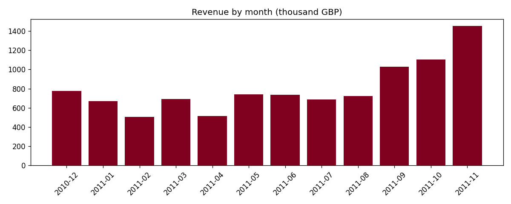
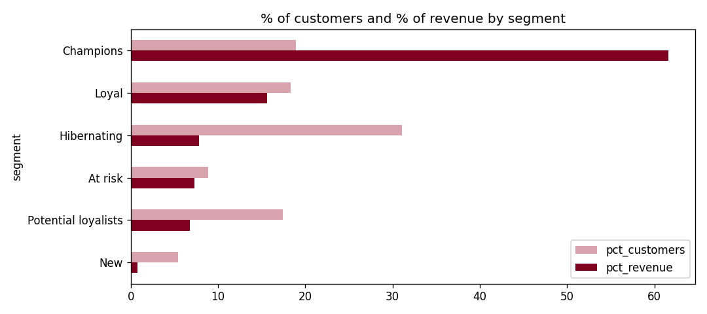
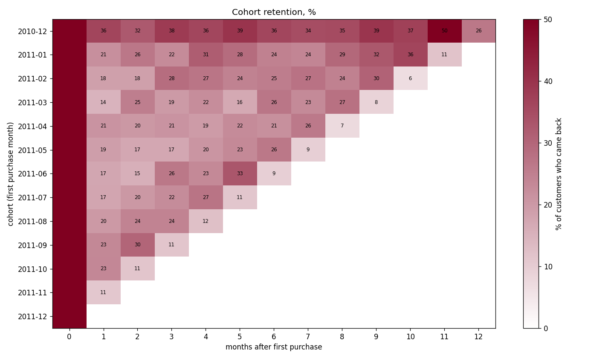
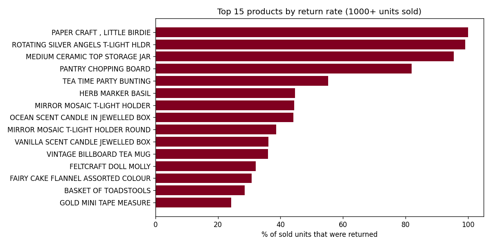

# Online Retail - SQL analysis

My SQL project on real sales data of a UK online gift shop (Dec 2010 - Dec 2011, about 540k rows).
I cleaned the data with SQL, split it into 4 tables and answered 5 business questions.

**Tools:** SQLite, SQL, Python (pandas, matplotlib), Jupyter Notebook

## Data

Online Retail dataset from the UCI Machine Learning Repository: https://archive.ics.uci.edu/dataset/352/online+retail

Columns: Invoice, StockCode, Description, Quantity, InvoiceDate, Price, Customer ID, Country.

The csv is not in the repo because it is too big (44 MB), see `data/README.md`.

## Questions

1. What is wrong with the raw data? - `sql/queries/01_data_quality.sql`
2. How does revenue change by month? - `sql/queries/02_monthly_revenue.sql`
3. Which customer groups are there (RFM)? - `sql/queries/03_rfm_segments.sql`
4. How many new customers come back? - `sql/queries/04_cohort_retention.sql`
5. Which products are returned most often? - `sql/queries/05_product_returns.sql`

## Cleaning

Problems I found in the raw data (541,910 rows):

| Problem | Rows | What I did |
|---------|------|------------|
| No Customer ID | 135,080 | kept for revenue, not used in RFM and cohorts |
| Cancellations (invoice starts with C) | 9,288 | kept, needed for returns |
| Exact duplicates | 5,268 | removed |
| Service codes (POST, M, BANK CHARGES, AMAZONFEE...) | 2,951 | removed |
| Price 0 or less | 2,517 | removed |
| Negative quantity that is not a cancellation | 1,336 | removed (stock corrections) |

After cleaning: **531,205 rows (98%)**. The total (sales minus cancellations, 9.77M GBP) is the same before and after splitting into tables.

## Tables

```
customers -< invoices -< invoice_items >- products
```

- customers (customer_id, country)
- products (stock_code, description)
- invoices (invoice_no, customer_id, invoice_date, country, is_cancelled)
- invoice_items (item_id, invoice_no, stock_code, quantity, price)

## Results

**Revenue by month**



Revenue is 500-750k per month in the first half of the year and grows a lot from September. November 2011 is the best month (1.45M), probably Christmas shopping.

**RFM segments**



Champions are 19% of customers but bring 62% of revenue. Hibernating customers are the biggest group (31%) and bring less than 8%.

**Cohort retention**



Usually only 20-25% of new customers buy again in a given month after the first purchase (but over the whole year 62% of customers came back at least once). The December 2010 cohort is much better (35-40%), probably because these are old customers who were buying before the data starts.

**Returns**



The top 3 are not normal returns: two of them are one huge order (74k and 81k units) cancelled 12-16 minutes later. Without them, TEA TIME PARTY BUNTING (55%) and HERB MARKER BASIL (45%) have the highest return rate.

## Main takeaway

The shop depends on two things: the Christmas season and a small group of loyal customers. September-November bring 35% of all revenue, and 19% of customers (Champions) bring 62% of it. At the same time only about 1 in 5 new customers buys again in the next month. So the biggest opportunity is to turn first-time buyers into regular ones, ideally before the autumn season starts.

Also worth knowing: 85% of revenue comes from the UK, and 15% of revenue comes from orders without a Customer ID, so RFM and cohorts do not include it.

## What I would recommend

- a loyalty program for Champions, because they bring most of the money
- a personal offer for "At risk" customers (on average they bought 4 times but have not come back for ~4 months)
- a follow-up email after the first order, because about 4 of 5 new customers don't buy again in the next month
- check the products with high return rate (quality or wrong description on the site)

## How to run

```bash
python3 -m venv .venv
source .venv/bin/activate
pip install -r requirements.txt
```

Put `online_retail_II.csv` into `data/` and run all cells in `analysis.ipynb`.
